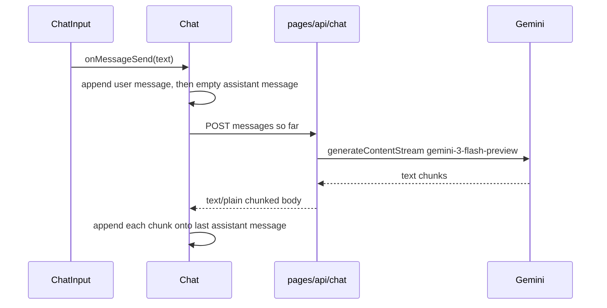

# AI Chat — project guide

Living source of truth for this repo. Read this before changing the app. When a roadmap item ships, check it off here in the same change.

This file describes what is built today and the planned work after it. It is written for a person or an agent picking the project up cold.

## Purpose

A single-page chat UI that streams replies from Google Gemini. Conversations are stored in the browser and listed in a sidebar. There is no auth and no settings UI.

The product name in the header is the string `ChatGpt`. The model behind it is Gemini.

## Stack

| Piece | Choice |
|---|---|
| Framework | Next.js 16.2 Pages Router (`src/pages`), React 19 |
| Language | TypeScript, `strict` |
| Styling | SCSS modules for components. Tailwind 4 is imported in `src/styles/globals.css` and is unused by components |
| Markdown | `react-markdown` + `remark-gfm` for assistant messages |
| Icons | `lucide-react` (`SendHorizontal`, `Square`, `Trash2`, `Paperclip`) |
| IDs | `uuid` v4 |
| Model SDK | `@google/genai` on the server |
| Compiler | React Compiler on (`reactCompiler: true`). `reactStrictMode` is off |

Scripts in `package.json`:

- `npm run dev` — Next dev server
- `npm run build` — production build
- `npm start` — serve the production build
- `npm run lint` — ESLint (`eslint.config.mjs`, `eslint-config-next`)

## How to run

1. Install dependencies: `npm install`
2. Put the key in `.env.local` at the repo root:

   ```
   GEMINI_API_KEY=your_key
   ```

   `.env*` is gitignored. The key is read only in `src/lib/gemini.ts` on the server. Do not send it to the browser.
3. `npm run dev` and open the local URL Next prints.

There is no README, no `.env.example`, and no test suite.

## Directory map

```
src/
  pages/
    index.tsx              Home: sidebar plus a column of Header and Chat.
    _app.tsx               Imports globals.css only.
    _document.tsx          lang="en", antialiased body.
    styles.module.scss     Full-viewport dark page (#2f2f2f).
    api/
      chat.ts              POST streaming chat.
      document.ts          POST one file as base64. Returns extracted text. Does not call Gemini.
      hello.ts             Unused Next boilerplate. Safe to delete.
  components/
    Layout/Header.tsx      Fixed 54px bar. Label "ChatGpt". New chat button.
    Layout/Sidebar.tsx     Conversation list, select, delete, and new chat.
    Chat/Chat.tsx          State, send, stream reader.
    Chat/ChatInput.tsx     Textarea, document attach, and send icon.
    Chat/MessageList.tsx   Scrolls to the latest message.
    Chat/Message.tsx       User text or assistant markdown. Memoized on id, content, and status.
    Chat/CodeBlock.tsx     Fenced code wrapper. Prism highlight, or plain pre. Copy writes the raw fence.
    Chat/CopyButton.tsx    Clipboard write with Copied / Copy failed on the button.
    Chat/EmptyState.tsx    "Hi, How can I help you today?"
  hooks/                   Empty. No hooks yet.
  lib/gemini.ts            GoogleGenAI client.
  lib/document.ts          Shared document size, type, and text limits.
  lib/extractDocument.ts   Server PDF and text extraction. Not imported by components.
  lib/uploadDocument.ts    Browser upload to /api/document.
  lib/storage.ts           localStorage ChatStore under ai-chat:v1.
  lib/publicError.ts       Maps provider failures to safe sentences.
  lib/streamMarker.ts      Trailing stream-error marker shared by API and client.
  types/chat.ts            Message type.
  styles/globals.css       Tailwind import + unused light/dark CSS variables.
```

Path alias: `@/*` → `src/*` (`tsconfig.json`).

Layout math, used by later UI work:

- The page is `100vh` and a row: a 260px sidebar, then the header/chat column. The header is `54px` tall and is a sibling of `Chat`, not a child of it. Chat width percentages are of that column.
- `.chat-container` is `height: calc(100% - 54px)` and a column flex. That `54px` is the header.
- The chat column width is `60%`, centered.
- The message list is `flex: 1; min-height: 0; overflow: auto`. The composer sits under it in normal flow, `min-height: 54px`, with `24px` of space below it. The textarea grows to `160px`, then scrolls.

## Data model today

`src/types/chat.ts`:

```ts
export type Role = "user" | "assistant";

export interface Message {
  id: string;
  role: Role;
  content: string;
}
```

`Chat` holds `messages: Message[]` and `isThinking: boolean`. Both start empty / false. There is no conversation id, title, error field, or settings object.

## Request path



### Client (`src/components/Chat/Chat.tsx`)

`handleSendMessage` appends the user message and calls `streamAssistantReply(history)`. The history posted to `/api/chat` includes that user message and not the empty assistant placeholder. An assistant message with empty content is left out of the next request.

`streamAssistantReply`:

1. Bumps a request id and aborts any previous controller. Creates an `AbortController`, stores it on a ref, and passes `signal` to `fetch`.
2. Appends an assistant `Message` with `content: ""` and `status: "streaming"`. `Message` renders that as `Thinking...` until text arrives.
3. Reads the body with `TextDecoder`, calling `decode(value, { stream: true })`, then a final `decode()` to flush trailing bytes. A trailing `\n[[ai-chat:error]]` is stripped and never shown.
4. Each chunk replaces the assistant message with that id. A new object is written into a copied array. If the id is gone, the chunk is ignored.
5. `AbortError` is not an error. If that placeholder is still empty, it is removed. Partial text stays with `status: "cancelled"`.
6. Any other failure sets `status: "error"` and a short `error` string on that assistant message, and keeps partial text. `Thinking...` is only the empty streaming state.
7. `finally` sets `isThinking` to false only when the request id is still the latest one. Retry deletes that assistant message and calls `streamAssistantReply` with the history above it.

Stop calls `abort()` and sets `isThinking` to false immediately. Unmount aborts the in-flight controller. State is a `ChatStore`: the screen shows `conversations` for `activeId`. New chat aborts any in-flight reply, prepends another conversation, and selects it. The sidebar lists every conversation, newest `updatedAt` first. Selecting another conversation, or deleting the open one, aborts the in-flight reply. A chunk or a `complete` status is written only when `activeId` is still that conversation, so a late update after a switch is dropped. Abort still marks the conversation that started the request as `cancelled`, or removes an empty placeholder. The composer remounts with the active conversation id, so its text clears. A `useEffect` writes the store to `localStorage` on each change.

### Composer (`src/components/Chat/ChatInput.tsx`)

- Local `query` state. Placeholder `Ask anything!`. `rows={1}`. `resize: none` in SCSS. The field grows with the text up to `160px`, then scrolls, and returns to one line when `query` is empty.
- Enter sends. Shift+Enter inserts a newline.
- Send is ignored when `isThinking` is true, or when the trimmed query is empty and no file is attached. A file with an empty box sends the question `Review this document.`
- One file can be attached: PDF, `.txt`, or `.md`. The name shows above the field, with Remove. An unsupported type or a file over 8 MB shows a short error and is not attached.
- While `isThinking`, the send icon is a stop button (`Square`) that calls `onStop`. Enter still does not send.
- The query and the file clear only after the document is read and the send is accepted. A failed read keeps both and shows the error under the file name.

### API (`src/pages/api/chat.ts`)

- Methods other than POST → `405` `{ error: "Method not allowed" }`.
- Missing or non-array `messages` → `400` `{ error: "Messages are required" }`.
- Otherwise `gemini.models.generateContentStream` with model `gemini-3-flash-preview`.
- Each client message is mapped to `{ role, parts: [{ text }] }`. `assistant` is sent as Gemini role `model`. Any other role is sent as `user`. Client state still stores `assistant`. When a user message has `attachment.text`, that part is `message.content`, a blank line, `Document: {name}`, and the extracted text. Attachment text longer than 200,000 characters is `400` `{ error: "This document is too long." }` and is not sent to Gemini.
- Response headers: `200`, `Content-Type: text/plain; charset=utf-8`, chunked. Each `chunk.text` is written raw. No SSE framing, no JSON lines.
- A missing `GEMINI_API_KEY` returns `500` `{ error: "API key is not configured" }` before calling Gemini.
- On throw: log the original error on the server only. If headers are not sent, `500` with one of: `This model is unavailable` (404 / not found), `Rate limit reached. Try again in a moment.` (429 / quota), or `Something went wrong`. The body never includes the provider payload or the key.
- If the throw happens after `writeHead`, the handler writes `\n[[ai-chat:error]]` and ends. The client strips that suffix, keeps any partial text, and shows `Something went wrong`.

### Gemini client (`src/lib/gemini.ts`)

```ts
export const gemini = new GoogleGenAI({
  apiKey: process.env.GEMINI_API_KEY,
});
```

The client is created at module load. A missing key is rejected in the API route before Gemini is called, and the chat shows `API key is not configured`.

## UI behavior today

- Empty `messages` shows `EmptyState`. Any length shows `MessageList`.
- User bubbles are right-aligned plain text, with Edit when nothing is streaming. If that message has an attachment, the file name is shown and the extracted text is not. Save rewrites that message, drops every later message, and streams a new reply. Cancel leaves the transcript unchanged. Assistant bubbles are left-aligned markdown (`remark-gfm`: tables, strikethrough, task lists).
- Fenced code in assistant messages is highlighted with Prism (`react-syntax-highlighter`, `oneDark`) when the language tag is one Prism knows, including aliases such as `js` and `ts`. A missing or unknown language stays plain preformatted text inside the same `CodeBlock` wrapper. Each block has Copy, which writes that fence's raw source. Inline code stays inline. User messages stay plain text. A finished assistant message has Copy response, which writes `message.content`. Both controls are hidden while that message is `streaming` or empty. A clipboard rejection changes the button to `Copy failed` and does not alert. `Message` skips re-rendering when its id, content, status, error, streaming flag, and regenerate flag are unchanged, so a chunk does not redraw earlier bubbles. `CodeBlock` skips re-highlighting when its source and language are unchanged.
- `MessageList` follows the bottom when a message is added, and during streaming only if the reader has not scrolled up. A scroll that decreases `scrollTop` stops following until the list is within 80px of the bottom again. Chunks use `behavior: "auto"`; a new message uses `"smooth"`.
- `.thinking` in `src/components/Chat/message.module.scss` pulses the empty streaming bubble. An assistant message with `status: "error"` shows its `error` string and a Retry button. The latest assistant message also shows Regenerate when it is `complete`, `cancelled`, or `error` and nothing is streaming.
- Colors are hardcoded dark (`#2f2f2f` page, `#212121` bubbles and composer). `globals.css` light/dark variables do not drive the chat.
- `src/pages/index.tsx` imports `Geist` and `Geist_Mono` from `next/font/google` and never uses them. `globals.css` references `--font-geist-sans` / `--font-geist-mono`, which are never set. Body font is Arial; the header sets `font-family: Roboto` without loading that font.

## Constraints later features must respect

These are bugs or missing seams. Each one names the roadmap item that should fix it. Do not "clean them up" in an unrelated change.

1. **Gemini roles. Shipped in feature 0.** `src/pages/api/chat.ts` maps `assistant` to Gemini role `model` and anything else to `user`. Client messages stay `"assistant"`. Do not forward `message.role` unchanged.
2. **Stream updates. Shipped in feature 1.** `appendChunk` in `Chat.tsx` replaces the assistant message with the id captured for that request. Do not write chunks onto the last index, and do not mutate `message.content` in place.
3. **UTF-8. Shipped in feature 1.** The reader uses `decode(value, { stream: true })` and flushes with a final `decode()`. Do not drop `{ stream: true }`. There is no chunk `console.log`.
4. **Error status. Shipped in feature 2.** `Thinking...` is only an empty message that is still `streaming` (or has no status). `status: "error"` shows `message.error` and Retry. Do not infer failure from an empty string.
5. **No settings UI.** The sidebar shipped in feature 7 and reads the feature 6 `ChatStore`. Do not add a storage key. The model string `gemini-3-flash-preview` stays hardcoded in the API until feature 11, and each conversation already stores `settings.model`. A not-found response surfaces as `This model is unavailable`.
6. **React Strict Mode is off.** Effects do not double-invoke in dev. Do not rely on that. If Strict Mode is turned on later, the send effect must tolerate a remount (abort on cleanup).
7. **Streaming format stays plain text chunks. Shipped sentinel in feature 2.** Do not switch to SSE. Failures before the first byte stay a non-OK status plus a JSON `{ error }` body. Failures after headers are sent append `\n[[ai-chat:error]]`. The client strips that exact suffix. Do not show it, and do not treat a stream that ends without it as an error.
8. **Auto-scroll. Shipped in feature 1.** Follow the bottom on a new message. During a stream, stop following when `scrollTop` decreases, and resume within 80px of the bottom. Keep chunk scrolling on `behavior: "auto"`.

## Target data model

This shape is in `src/types/chat.ts` and is the `localStorage` payload. Do not persist a bare `Message[]`. Feature 7 reads this list. It does not get a new storage key.

```ts
export type Role = "user" | "assistant";

export interface Attachment {
  name: string;
  mimeType: string;
  text: string;
}

export interface Message {
  id: string;
  role: Role;
  content: string;
  status?: "streaming" | "complete" | "error" | "cancelled";
  error?: string;
  attachment?: Attachment;
}

export interface ConversationSettings {
  model: string;
}

export interface Conversation {
  id: string;
  title: string;
  messages: Message[];
  createdAt: number;
  updatedAt: number;
  settings: ConversationSettings;
}

export interface ChatStore {
  activeId: string;
  conversations: Conversation[];
}
```

Rules:

- `status` is optional so current messages stay valid. Set it once feature 2 exists. `"streaming"` replaces the "empty content means thinking" heuristic.
- `loadStore()` (feature 6) rewrites any stored `status: "streaming"` to `"cancelled"`. A tab closed mid-reply must not reload as a permanent `Thinking...`.
- Title: first user message, trimmed, capped (about 40 characters). Fallback `New chat` until the first send.
- `settings.model` defaults to the current hardcoded model until feature 11 exposes a control. Persist it from day one so a later settings change does not rewrite old records.
- Storage key: `ai-chat:v1`. If the shape changes, bump the suffix and ignore unknown payloads (fall back to one empty conversation). Do not throw on corrupt JSON.
- `attachment` is optional and only kept on a user message. It stores the file name, mime type, and extracted text. Raw file bytes are not stored. `loadStore()` drops an attachment whose text is empty or longer than 200,000 characters, and drops any attachment on an assistant message.
- The sidebar lists every conversation. The main column shows the active one.

## How to update this doc

When a feature lands:

- Check its boxes below.
- Add a short "Shipped" note under that feature if the implementation differed from this plan (file names, extra fields).
- Leave unchecked items as the remaining plan.

Do not implement features from this file unless the task asks for that feature.

## Out of scope

Unless a later request adds them:

- Accounts, auth, or server-side chat history
- Sharing, export, or search across chats
- Image uploads, Word documents, and OCR. PDF and plain-text documents are feature 13
- Tool calling, or a system prompt UI
- Changing the stream from raw `text/plain` chunks to another protocol
- Replacing SCSS modules with Tailwind, or a visual redesign beyond what a feature needs
- Deleting `src/pages/api/hello.ts` or the unused Geist imports, except as a tiny cleanup inside a feature that already edits those files

---

## Roadmap

Order is the priority order. Each item lists what the user sees, which files to touch, what it depends on, and when it is done.

Shared send helper, introduce it in feature 1 and reuse it: one function in `Chat.tsx` (or `src/lib/streamChat.ts` if the component gets crowded) that accepts the message list to send, creates the assistant placeholder, fetches, and reads chunks. It closes over that assistant message's `id` and updates by id. Regenerate, edit, and retry should call that helper instead of copying the loop.

### 0. Gemini role map

Learn: the contents API's role names. Ship this alone, before feature 1. Multi-turn chat is broken until it lands, and the fix is not part of the error-handling UX.

**Behavior.** No UI change. A second message in the same conversation gets a reply instead of a rejected request.

**Files.** `src/pages/api/chat.ts` only. Map roles when building `contents`:

```ts
role: message.role === "assistant" ? "model" : "user",
```

**Connects to.** Feature 2 still owns what the user sees when Gemini fails, including a preview model id that starts 404ing. This item only makes the second turn valid.

**Shipped.** The map matches the snippet above. No other files changed.

**Done when.**

- [x] A second user message in one chat streams a reply
- [x] Client messages still use role `"assistant"`
- [x] The Gemini request uses `"model"` for those messages

### 1. Stop / cancel generation

Learn: `AbortController`, request lifecycle.

**Behavior.** While a reply is streaming, the composer shows a stop control instead of send. Activating it aborts the `fetch` and the reader. The partial assistant text stays on screen. `isThinking` becomes false so the user can type again. Enter does not send while a request is in flight (unchanged). Stopping is not an error.

While a reply is streaming, the list auto-scrolls only if it is already near the bottom (about 80px). Use instant scrolling during the stream. A new user send still brings the latest message into view. Scrolling up to read stays put.

**Files.**

- `src/components/Chat/Chat.tsx` — hold the controller in a ref. Pass `signal` to `fetch`. On abort, stop the read loop. Ignore `AbortError` in the catch. In `finally`, clear thinking only for the request that just finished (ignore a stale completion if a newer send exists; a generation counter or comparing the controller ref is enough). Decode with `{ stream: true }`. Remove the chunk `console.log`. Update the assistant message by the id captured when the placeholder was created; skip the chunk if that id is gone. Replace the message object instead of mutating it.
- `src/components/Chat/ChatInput.tsx` — stop button while `isThinking`, calling a new `onStop` prop. Use a square/stop icon from `lucide-react`. Send stays disabled during thinking.
- `src/components/Chat/MessageList.tsx` — near-bottom check before following the sentinel. Pass whether a reply is streaming so the behavior is `auto` during chunks and `smooth` on a new send.

**Connects to.** Feature 2 must not treat abort as a failure banner. Feature 3 and 4 call `streamAssistantReply`, so they get stop, id-targeted updates, and the UTF-8 decode for free.

**Shipped.** Stop is a filled `Square` button. Abort removes an assistant placeholder that is still empty, so a stop before the first token does not leave `Thinking...`. Partial text stays. Unmount aborts the controller. A request id guard keeps a newer send from being cleared by the aborted request's `finally`.

**Done when.**

- [x] Stop aborts the in-flight request and the UI becomes usable immediately
- [x] Partial text remains; no error banner on abort
- [x] A send started after stop is not overwritten by the aborted request
- [x] Chunks update the assistant message with that id, immutably, and a chunk whose id is gone is ignored
- [x] A multi-byte character split across chunks is not replaced with U+FFFD
- [x] The chunk `console.log` is gone
- [x] Scrolling up during a stream stays put, and a new send still brings the latest message into view

### 2. Error handling UX

Learn: API failures, retries, error states.

**Behavior.** If the POST fails, the body is missing, or the stream throws (except abort), the assistant placeholder shows an error message and a Retry action. It must not keep saying `Thinking...`. Retry resends the same user history. When the response is not OK and the body parses, show its `error` string. Network failures get a generic sentence.

The API must stop using one sentence for every failure. Map a few known cases to distinct messages that do not include the provider payload, the API key, or the request body. Log the original error on the server only.

- Missing `GEMINI_API_KEY` → `API key is not configured`
- Model not found, including a retired preview id → `This model is unavailable`
- Quota or HTTP 429 → `Rate limit reached. Try again in a moment.`
- Anything else before headers → `Something went wrong`

If the failure happens after headers are sent, write the exact suffix `\n[[ai-chat:error]]` and then end the response. The client strips a trailing `[[ai-chat:error]]` from the assistant content, does not show the marker, and sets `status: "error"` with `Something went wrong`. A reply that ends without the marker is complete, partial text included. If the model itself emits that exact suffix, the reply is treated as failed. That collision is accepted.

**Files.**

- `src/types/chat.ts` — add optional `status` and `error` on `Message` (see target model). Do not add `Conversation` yet.
- `src/components/Chat/Chat.tsx` — set `status: "error"` and `error` on the placeholder, by id. Retry calls the shared send helper with messages up to and including the last user message, after removing the failed assistant message. On a clean end of stream, strip the sentinel if present.
- `src/components/Chat/Message.tsx` — render error + Retry only when `status === "error"`. Render `Thinking...` only when content is empty and status is streaming (or content is empty and there is no error). Wire the unused `.thinking` class if it still matches the look.
- `src/pages/api/chat.ts` — the error map above, and the sentinel write in the `headersSent` branch. The role map is feature 0; do not redo it here.

**Connects to.** Feature 0 has already made the second turn valid. Feature 3's regenerate is almost the same call as Retry. Feature 11's preview model id already surfaces as `This model is unavailable`.

**Shipped.** `Message.status` and `Message.error` are on the client type. `Conversation` is still not added. Retry calls `streamAssistantReply` with the messages above the failed assistant. The marker is shared as `STREAM_ERROR_MARKER` in `src/lib/streamMarker.ts`.

**Done when.**

- [x] Failed requests show an error on that assistant message and a Retry control
- [x] Abort does not show that error
- [x] A failure after the first chunk keeps the partial text, shows the error, and does not leave the marker visible
- [x] Missing key, retired model, and quota show the three distinct messages above
- [x] The client still does not receive the raw provider error
- [x] Retry produces a new assistant reply without duplicating the user message

### 3. Regenerate response

Learn: request reconstruction, state management.

**Behavior.** The latest assistant message has a Regenerate control when it is complete, cancelled, or in error, and nothing is streaming. Clicking it removes that assistant message and requests a new reply from the history above it (the same user message and everything before it).

**Files.**

- `src/components/Chat/Message.tsx` — button, only on the last assistant message. Pass a callback from `Chat` via `MessageList`.
- `src/components/Chat/Chat.tsx` — slice messages to before that assistant id, then call the shared send helper. Do not append a second user message.

**Connects to.** Uses the feature 1 helper and feature 2 error/status. No API change. Regenerate calls the same resend as Retry: drop that assistant message and call `streamAssistantReply` with the history above it.

**Shipped.** The button is only on the latest assistant message. Retry stays on error messages, including older ones.

**Done when.**

- [x] Regenerate replaces only the latest assistant message
- [x] Earlier turns stay intact and are included in the request
- [x] The control is hidden while a reply is streaming
- [x] Stop and error/retry still work on the new reply

### 4. Edit and resend a user message

Learn: message manipulation.

**Behavior.** A user bubble can be edited (click Edit, change text, Save or Cancel). Save replaces that message's content, deletes every message after it, and sends the truncated history. Cancel restores the previous text and does not send. Editing is disabled while `isThinking`.

**Files.**

- `src/components/Chat/Message.tsx` — edit mode for `role === "user"` (textarea or input, Save, Cancel).
- `src/components/Chat/Chat.tsx` — `onEdit(id, nextText)` finds the index, keeps messages before it, replaces that user message (new object, same id), drops the tail, then calls the shared send helper.

**Connects to.** Same truncation rule feature 7's per-conversation messages will use. Do not edit messages in other conversations; there is only one list until feature 7.

**Shipped.** Save stores the trimmed text on the same message id, drops the tail, and calls `streamAssistantReply`. Escape cancels. Save stays disabled when the trimmed draft is empty.

**Done when.**

- [x] Save rewrites that user message, drops later messages, and streams a new reply
- [x] Cancel leaves the transcript unchanged
- [x] Empty trimmed text cannot be saved
- [x] Edit controls are unavailable while streaming

### 5. New chat / reset conversation

Learn: conversation lifecycle.

**Behavior.** A New chat control in the header clears the transcript and shows `EmptyState`. If a reply is streaming, abort it first (feature 1). The composer clears.

**Files.**

- Keep `Header` and `Chat` as siblings in `src/pages/index.tsx`. Do not render `Header` inside `Chat`. `.chat-container` is `height: calc(100% - 54px)` because the header is that sibling; nesting it would double-count the 54px and break the layout.
- `src/components/Layout/Header.tsx` — New chat button and an `onNewChat` prop. Leave `Header` presentational.
- `src/pages/index.tsx` — hold a `resetKey` and pass `key={resetKey}` to `Chat`. New chat increments the key, which remounts `Chat` empty and clears the composer. This is the cheap version. Features 6 and 7 lift conversation state and replace the remount with a store action.
- `src/components/Chat/Chat.tsx` — abort the in-flight request in an effect cleanup so the remount cannot apply leftover chunks.

**Connects to.** Feature 6 treats New chat as "append a `Conversation` and select it" instead of remounting. Swap the handler body then. Do not introduce the store in this feature.

**Shipped.** `Header` stays a sibling of `Chat` and only receives `onNewChat`. Abort-on-unmount was already in `Chat` from feature 1. Feature 6 replaced the `resetKey` remount: New chat now appends a stored conversation. Do not put the remount back.

**Done when.**

- [x] New chat shows the empty state and an empty composer
- [x] An in-flight reply is aborted and does not reappear
- [x] Sending after reset starts a fresh history with no previous turns in the POST body

### 6. Chat persistence

Learn: `localStorage`, serialization.

**Behavior.** Reload restores the active conversation, including messages and the model setting. Writes happen when messages or settings change (a `useEffect` on the store is enough; debounce is optional). Corrupt or missing storage starts a new empty conversation.

**Files.**

- `src/types/chat.ts` — add `Conversation`, `ConversationSettings`, `ChatStore` from the target model.
- `src/lib/storage.ts` — `loadStore()` / `saveStore()` for key `ai-chat:v1`. Guard `window`. Ignore parse errors. On load, rewrite every message with `status: "streaming"` to `status: "cancelled"` so a closed tab does not come back as `Thinking...`. Drop an assistant message that is still empty unless its status is `error` — that is the same placeholder Stop removes, and it must not come back as a bare Regenerate button.
- `src/components/Chat/Chat.tsx` — initialize from storage. Persist the `Conversation` shape even though the UI still shows one chat. New chat (feature 5) appends a new conversation and sets `activeId`, or replaces the single slot if you truly only keep one until feature 7. **Keep a list.** One element is fine. New chat pushes another item and switches `activeId` so feature 7 is a UI over existing data.
- Title: set from the first user message when it is sent, if the title is still `New chat`.

**Connects to.** Feature 7 reads this list. Do not persist a bare `Message[]`.

**Shipped.** `loadStore` / `saveStore` use `ai-chat:v1`. The UI still shows one conversation. New chat prepends another and selects it. Titles come from the first user message, trimmed and capped at 40 characters. `settings.model` is stored as `gemini-3-flash-preview` and is not sent to the API yet. A reload during `Thinking...` drops that empty assistant message and keeps the user message. Partial text reloads as `cancelled`.

**Done when.**

- [x] Reload restores messages, title, active id, and settings
- [x] Storage shape is `ChatStore` under `ai-chat:v1`
- [x] Bad JSON falls back to one empty conversation
- [x] A message saved while `streaming` reloads as `cancelled`, not as `Thinking...`. An empty assistant placeholder is dropped instead of showing only Regenerate
- [x] New chat creates another stored conversation without deleting the previous one
- [x] The API key is never written to storage

### 7. Multiple conversations / sidebar

Learn: data modeling, state architecture.

**Behavior.** A sidebar lists conversations by title, newest `updatedAt` first. Clicking one loads it. New chat (header or sidebar) creates one and selects it. Each row can delete that conversation. Deleting the active one selects a neighbor, or creates an empty conversation if the list would be empty. The main column is the active conversation only. Switching chats aborts any in-flight stream so chunks cannot land in the wrong conversation.

**Files.**

- `src/components/Layout/Sidebar.tsx` plus `sidebar.module.scss` — list, select, delete, new.
- `src/pages/index.tsx` and `src/pages/styles.module.scss` — row layout: sidebar + current header/chat column. Narrow the 60% column only if the sidebar makes it overflow; keep the dark page.
- `src/components/Chat/Chat.tsx` — read and write `conversations[activeId]`. Include `activeId` in the stream completion check so a late chunk is dropped after a switch.

**Connects to.** Persistence from feature 6 is the state. No new storage key. Settings from feature 11 are per conversation (`conversation.settings`).

**Shipped.** `Sidebar` is a full-height sibling of the header/chat column. Rows are `conversation.title`, newest `updatedAt` first. Header and sidebar New chat both prepend and select. Delete removes that row. Deleting the open chat aborts its reply and selects the next row in that order, or the previous row if it was last. Deleting a different row leaves the active reply running. An empty list is replaced with one new conversation. Editing the first user message updates the title. Chunks and `complete` are applied only while that conversation is still active.

**Done when.**

- [x] Create, switch, and delete conversations persist across reload
- [x] The message list always matches the selected conversation
- [x] Switching or deleting aborts an in-flight reply
- [x] The list is never empty after a delete (a fresh conversation is created)
- [x] Titles stay in sync with the first user message

### 8. Code syntax highlighting

Learn: markdown customization.

**Behavior.** Fenced code in assistant markdown is highlighted by language. Unknown or missing languages stay readable (plain preformatted text). Inline code stays inline. User messages stay plain text, not markdown.

**Files.**

- `src/components/Chat/Message.tsx` — `ReactMarkdown` `components` override for `code` / `pre`. Memoize `Message` on `id`, `content`, and `status` so a streaming chunk does not re-render earlier bubbles. `ReactMarkdown` still re-parses the one message that is growing; that is acceptable.
- Memoize the code-block component on its source string so unchanged fences are not re-highlighted on every token.
- Add one highlighter dependency. Prefer `react-syntax-highlighter` with one style that fits the `#212121` bubble, or `shiki` if the bundle tradeoff is acceptable. Do not add both.
- Keep `remark-gfm`.

**Connects to.** Feature 9 puts the copy button on the same code block wrapper. Build the wrapper in this feature so feature 9 only adds the button.

**Shipped.** `CodeBlock` is the wrapper. It receives the raw fence text and the language tag. Feature 9 should add the copy button there and write that raw string, not the highlighted DOM. Prism's `oneDark` theme is the only highlighter. The `Message` compare also includes `error`, `isStreaming`, and `canRegenerate` so Edit and Regenerate appear when a stream ends; a chunk still does not re-render earlier bubbles.

**Done when.**

- [x] A fenced block with a language tag is highlighted
- [x] A fence without a language still renders as code
- [x] Inline code is not rendered as a block
- [x] Streaming markdown does not crash on an unclosed fence (partial blocks may be unstyled until the fence closes; that is acceptable)
- [x] Earlier messages do not re-render when a later message's content streams
- [x] An unchanged code block is not re-highlighted on later tokens

### 9. Copy code / copy response

Learn: DOM and Clipboard API, small UX.

**Behavior.** Each code block has Copy. It writes the raw code (not the highlighted DOM) and briefly shows Copied. Each completed assistant message has Copy response, writing `message.content` markdown source. Hide both while `status === "streaming"` or content is empty. If `navigator.clipboard` rejects, show a short failure on the button; do not alert.

**Files.**

- The code-block wrapper from feature 8.
- `src/components/Chat/Message.tsx` — assistant copy control.
- No new dependency required (`navigator.clipboard.writeText`).

**Connects to.** Independent of sidebar and storage. Uses `status` from feature 2 so a streaming message is not copied mid-token. If feature 2 is somehow missing, hide copy when `isThinking` and the message is the last assistant message.

**Shipped.** Copy on `CodeBlock` writes the `code` prop. Copy response writes `message.content`. Both are hidden while `status` is `streaming` or the message content is empty. The button shows `Copied` for two seconds, or `Copy failed` when `clipboard.writeText` is missing or rejects.

**Done when.**

- [x] Copy on a code block writes only that block's source
- [x] Copy response writes the full assistant markdown
- [x] The control is absent or disabled while that message is streaming
- [x] Clipboard failure is visible on the control and does not throw into the chat

### 10. Auto-resizing textarea

Learn: DOM measurements, UX.

**Behavior.** The composer grows with the content up to a max height (about 160px), then scrolls inside the textarea. It shrinks when text is deleted and resets to one line after send. Shift+Enter still inserts a newline. Enter still sends.

**Files.**

- `src/components/Chat/ChatInput.tsx` — on change, set height to `auto`, then `scrollHeight`, capped. Reset height when `query` becomes `""`.
- `src/components/Chat/chatInput.module.scss` — `max-height`, `overflow-y: auto`. Keep `resize: none`.

**Layout (required).** A growing composer will cover the last messages. The list height is a static `calc(100% - 54px - 24px)`, and that `54px` is the composer's min-height, not the header. The composer is `position: absolute`, so it does not push the list. Make `.chat-container` a column flex: the list is `flex: 1; min-height: 0; overflow: auto`, and the composer sits in normal flow under it. Drop the absolute positioning, or use an equivalent that reserves the composer's real height.

**Shipped.** The textarea height is set from `scrollHeight`, capped at 160px. `.chat-container` is a column. The list and empty state use `flex: 1; min-height: 0`. The composer is in normal flow with 24px below it.

**Done when.**

- [x] One line stays one line tall
- [x] Several lines grow the field until the max, then the field scrolls
- [x] After send, the field returns to one line
- [x] The latest message stays visible above the composer when the field is at max height

### 11. Model / settings controls

Learn: API parameters, UI state.

**Behavior.** A small control (header or a popover on the composer) sets the model for the **active** conversation. Changing it does not resend history. The next send includes the chosen model. Default remains `gemini-3-flash-preview`. Optional: a temperature number if it is sent in the same change; otherwise ship model only and leave a `settings` field ready for more keys.

**Files.**

- `src/lib/models.ts` — export `DEFAULT_MODEL` (`gemini-3-flash-preview`) and the allowlist. Both the API and the picker import this module so the dropdown cannot offer an id the server rejects.
- `src/components/Chat/Chat.tsx` — pass `conversation.settings` into the POST body: `{ messages, model }`.
- `src/pages/api/chat.ts` — use `req.body.model` when it is in the allowlist; otherwise `DEFAULT_MODEL`. Do not pass arbitrary strings through to Gemini. Add other current Gemini model ids only after verifying them while implementing.
- Sidebar rows do not need the model name unless it fits without crowding.

`gemini-3-flash-preview` is a preview id and can start returning not-found. When it does, feature 2's `This model is unavailable` is the message the user should see. Do not special-case a fallback model silently.

**Connects to.** `Conversation.settings` already exists from feature 6, so this is a UI plus the API reading the field. Persist the change through the existing store effect.

**Skipped.** No model picker. The API keeps the hardcoded `gemini-3-flash-preview`. `settings.model` stays on each conversation for storage compatibility, and it is not sent.

**Done when.**

- [ ] The selected model is stored on the conversation and restored on reload
- [ ] The POST body includes `model`, and the API uses it only if it is in the allowlist
- [ ] An unknown model falls back to the default
- [ ] Two conversations can use different models

### 12. Deploy

Learn: environment variables, production concerns.

**Behavior.** The app builds and runs in production with `GEMINI_API_KEY` set in the host's environment. The key is not in the client bundle, not in git, and not required at build time beyond what Next already does for server code. `npm run build` succeeds.

**Files / host.**

- Vercel (or equivalent) project for this Next Pages app. `src/pages/api/chat.ts` stays a Node server route so the SDK and the key stay on the server.
- Document the env var in this file (already under How to run). Do not commit `.env.local`.
- Confirm `next.config.ts` needs no `env` block that would inline the key. `process.env.GEMINI_API_KEY` in `src/lib/gemini.ts` is server-only as long as that module is not imported by client components. Keep it that way. Client code talks only to `/api/chat`.
- A serverless host can buffer a chunked response so the whole reply arrives at once. Before the first chunk, call `res.flushHeaders()` and set `X-Accel-Buffering: no`. Check in production that tokens arrive incrementally.
- The route is public, has no auth, and spends the Gemini quota. Auth stays out of scope. Do not add a rate limiter in this feature. Before sharing a public URL, turn on the host's access control (Vercel Deployment Protection or equivalent). An open URL is an accepted risk only for a private learning deploy. Say which of the two you chose in the deploy notes.

**Connects to.** No feature work should import `src/lib/gemini.ts` from a component.

**Deferred.** Do not deploy yet. Leave this item until a later request.

**Done when.**

- [ ] `npm run build` succeeds
- [ ] Production has `GEMINI_API_KEY` set and a real send streams a reply
- [ ] Tokens arrive incrementally in production, not as one buffered body
- [ ] The client bundle does not contain the key
- [ ] `.env*` stays gitignored
- [ ] The deploy is either behind host access control, or the notes record that an open URL is an accepted risk

### 13. Document upload

Learn: file input, sending a document to Gemini without putting the API key in the browser, and keeping that text in the conversation.

**Feasible.** Gemini already accepts document text in the same `generateContent` call the chat uses. A resume review, interview preparation from a job description, or a PDF summary is the same chat: the user attaches a file and asks a question. This feature does not add separate modes for those tasks.

**Behavior.** The composer can attach one file: PDF, `.txt`, or `.md`. The user can remove it before sending. Send includes the question and the file. The user bubble shows the question and the file name, not the full document. Later messages in that chat can ask follow-ups without attaching the file again. A new chat does not see the previous chat's document.

The browser sends the file to a server route. That route extracts the text and returns it. The chat request stays `POST /api/chat` with the existing text stream. On each turn, the server adds the stored document text to that user message's Gemini part. Raw file bytes are not written to `localStorage`. The stored shape is the file name, the mime type, and the extracted text, on that user message.

Reject anything that is not PDF, plain text, or markdown, and reject a file over about 8 MB, with a short message on the composer. If a PDF has no text layer, say that it has no readable text. Do not add OCR. Cap the stored text at about 200,000 characters so one document cannot fill `localStorage`. A larger extraction is an error, not a silent trim.

An empty question with a file still sends. Use the question "Review this document." so a file alone is a valid request.

**Files.**

- `src/types/chat.ts` — optional `attachment` on `Message`: `{ name, mimeType, text }`. Only user messages have it.
- `src/pages/api/document.ts` — `POST` one file, return `{ name, mimeType, text }`. Raise the Pages body size limit enough for an 8 MB file. Do not call Gemini here, and do not read `GEMINI_API_KEY` into the response.
- `src/pages/api/chat.ts` — when a message has `attachment.text`, include that text in the Gemini `parts` for that turn, along with `message.content`. Keep the `assistant` → `model` role map. The response stays raw `text/plain` chunks.
- `src/components/Chat/ChatInput.tsx` — file control, chosen file name, remove, and send the file with the question.
- `src/components/Chat/Chat.tsx` — call the document route, store the returned attachment on the user message, then stream as today. Follow-up sends include that attachment because it is part of the history.
- `src/components/Chat/Message.tsx` — show the file name on the user bubble. The document body stays out of the bubble.

**Connects to.** Persistence from feature 6 stores the attachment with the conversation. Reload restores the file name and the extracted text, and the next question still uses it. Do not add a storage key. Do not import `src/lib/gemini.ts` from a component.

**Shipped.** The browser posts JSON `{ name, data }` to `/api/document`, with `data` as base64, so that route's body limit is `15mb`. The chat route's body limit is `4mb` so a history that includes extracted text still posts. PDF text uses `unpdf` in `src/lib/extractDocument.ts`. Shared limits live in `src/lib/document.ts`, and the browser upload is `src/lib/uploadDocument.ts`. A failed read leaves the composer text and the chosen file in place. The Gemini part is the question, then `Document: {name}`, then the extracted text.

**Done when.**

- [x] A PDF, `.txt`, or `.md` file can be attached, removed, and sent with a question
- [x] The reply uses the document (a resume review or a PDF summary answers from that file)
- [x] A follow-up in the same chat still uses the document, including after reload
- [x] Another conversation does not include that document
- [x] The user bubble shows the file name, not the extracted text
- [x] An unsupported type, a file over the size cap, or a PDF with no readable text shows a short error and does not send
- [x] The file bytes and the API key are not written to `localStorage`

## Suggested implementation order

The priority numbers above are the order to build. Three rules that override "do it as a drive-by":

- Feature 0 is shipped. Keep the `assistant` → `model` map in `src/pages/api/chat.ts`.
- Feature 1 is shipped. New sends and retries go through `streamAssistantReply` in `Chat.tsx`. Keep abort, id-targeted updates, `{ stream: true }`, and scroll anchoring.
- Feature 2 is shipped. Failures set `status: "error"`. Do not treat abort as an error, and do not render `Thinking...` for an error message.
- Feature 3 is shipped. Regenerate resends the history above the latest assistant message. Do not append a second user message.
- Feature 4 is shipped. Editing a user message keeps that id, drops every message after it, and resends. Do not send an empty trimmed edit.
- Feature 5 is shipped. Do not render `Header` inside `Chat`.
- Feature 6 is shipped. Persist `ChatStore` under `ai-chat:v1`. New chat appends a conversation. Do not go back to remounting `Chat`, and do not persist a bare `Message[]`.
- Feature 7 is shipped. The sidebar reads that list. Do not add a storage key. Switching, or deleting the open conversation, aborts the in-flight reply.
- Feature 8 is shipped. Highlight fenced code with Prism only. Do not add Shiki.
- Feature 9 is shipped. Copy writes the raw fence or the assistant markdown. Hide both while that message is streaming or empty. Do not alert on clipboard failure.
- Feature 10 is shipped. The composer grows to 160px in normal flow under the list. Do not put it back to `position: absolute`.
- Feature 11 is skipped. Do not add a model picker. Keep `gemini-3-flash-preview` hardcoded in the API.
- Feature 12 is deferred. Do not deploy until a later request.
- Feature 13 is shipped. Document upload is PDF, `.txt`, and `.md` only. Store extracted text on the user message. Do not put file bytes or the API key in `localStorage`, and do not change the chat stream to another protocol.
- Persist `ChatStore` in feature 6, before building the sidebar, so feature 7 does not migrate `localStorage`.

Features 8, 9, and 10 can land in parallel with 6 and 7 if needed. They touch `Message`, `ChatInput`, and the chat column layout. Features 1 through 5 should stay in order because they share the send helper.
