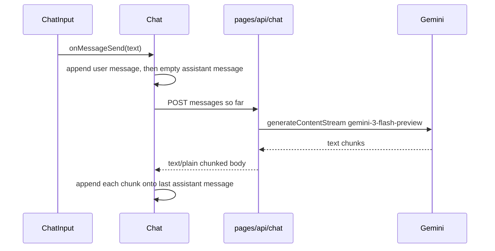

# AI Chat — project guide

Living source of truth for this repo. Read this before changing the app. When a roadmap item ships, check it off here in the same change.

This file describes what is built today and the planned work after it. It is written for a person or an agent picking the project up cold.

## Purpose

A single-page chat UI that streams replies from Google Gemini. The screen is one conversation held in React state. Nothing is saved across reloads. There is no auth, no sidebar, and no settings UI.

The product name in the header is the string `ChatGpt`. The model behind it is Gemini.

## Stack

| Piece | Choice |
|---|---|
| Framework | Next.js 16.2 Pages Router (`src/pages`), React 19 |
| Language | TypeScript, `strict` |
| Styling | SCSS modules for components. Tailwind 4 is imported in `src/styles/globals.css` and is unused by components |
| Markdown | `react-markdown` + `remark-gfm` for assistant messages |
| Icons | `lucide-react` (`SendHorizontal` only) |
| IDs | `uuid` v4 |
| Model SDK | `@google/genai` on the server |
| Compiler | React Compiler on (`reactCompiler: true`). `reactStrictMode` is off |

Scripts in `package.json`:

- `npm run dev` — Next dev server
- `npm run build` — production build
- `npm start` — serve the production build
- `npm run lint` — ESLint (`eslint.config.mjs`, `eslint-config-next`)

## How to run

1. Install dependencies: `npm install`
2. Put the key in `.env.local` at the repo root:

   ```
   GEMINI_API_KEY=your_key
   ```

   `.env*` is gitignored. The key is read only in `src/lib/gemini.ts` on the server. Do not send it to the browser.
3. `npm run dev` and open the local URL Next prints.

There is no README, no `.env.example`, and no test suite.

## Directory map

```
src/
  pages/
    index.tsx              Home: Header + Chat. Unused Geist font imports.
    _app.tsx               Imports globals.css only.
    _document.tsx          lang="en", antialiased body.
    styles.module.scss     Full-viewport dark page (#2f2f2f).
    api/
      chat.ts              POST streaming chat. The only real API.
      hello.ts             Unused Next boilerplate. Safe to delete.
  components/
    Layout/Header.tsx      Fixed 54px bar. Label "ChatGpt". No actions.
    Chat/Chat.tsx          State, send, stream reader.
    Chat/ChatInput.tsx     Textarea + send icon.
    Chat/MessageList.tsx   Scrolls to the latest message.
    Chat/Message.tsx       User text or assistant markdown.
    Chat/EmptyState.tsx    "Hi, How can I help you today?"
  lib/gemini.ts            GoogleGenAI client.
  types/chat.ts            Message type.
  styles/globals.css       Tailwind import + unused light/dark CSS variables.
```

Path alias: `@/*` → `src/*` (`tsconfig.json`).

Layout math, used by later UI work:

- Header height is `54px`.
- Chat column width is `60%`, centered.
- The composer sits `24px` from the bottom of the chat area (`position: absolute`).
- Message list height is `calc(100% - 54px - 24px)` so it clears the composer.

## Data model today

`src/types/chat.ts`:

```ts
export type Role = "user" | "assistant";

export interface Message {
  id: string;
  role: Role;
  content: string;
}
```

`Chat` holds `messages: Message[]` and `isThinking: boolean`. Both start empty / false. There is no conversation id, title, error field, or settings object.

## Request path



### Client (`src/components/Chat/Chat.tsx`)

`handleSendMessage`:

1. Build a user `Message` (`uuid`, role `user`, trimmed-or-not: the input trims only for the empty check; the raw string is sent).
2. `setMessages` to history plus that user message. `setIsthinking(true)`.
3. Append an assistant `Message` with `content: ""`. `Message` renders that as the text `Thinking...`.
4. `POST /api/chat` with JSON `{ messages: updatedMessages }`. `updatedMessages` is the history **plus the new user message, and not the empty assistant placeholder**.
5. If `response.ok` is false, throw. If `response.body` has no reader, throw.
6. Read the stream with `TextDecoder`. Each chunk mutates the last message: `lastMessage.content += chunk` inside `setMessages`, then returns the same object in a new array.
7. `catch` only `console.error`s. `finally` sets `isThinking` to false.

There is no `AbortController`. A failed request leaves the empty assistant message in the list, so the bubble keeps saying `Thinking...` after `isThinking` is false.

### Composer (`src/components/Chat/ChatInput.tsx`)

- Local `query` state. Placeholder `Ask anything!`. `rows={1}`. `resize: none` in SCSS.
- Enter sends. Shift+Enter inserts a newline.
- Send is ignored when `isThinking` is true or the trimmed query is empty.
- The send icon gets `send-button-disabled` and a gray stroke while thinking. It is still the send icon, not a stop control.
- The query clears as soon as send is accepted, before the response arrives.

### API (`src/pages/api/chat.ts`)

- Methods other than POST → `405` `{ error: "Method not allowed" }`.
- Missing or non-array `messages` → `400` `{ error: "Messages are required" }`.
- Otherwise `gemini.models.generateContentStream` with model `gemini-3-flash-preview`.
- Each client message is mapped to `{ role: message.role, parts: [{ text: message.content }] }`. Role is forwarded unchanged.
- Response headers: `200`, `Content-Type: text/plain; charset=utf-8`, chunked. Each `chunk.text` is written raw. No SSE framing, no JSON lines.
- On throw: log `Gemini API error`. If headers are not sent, `500` `{ error: "Something went wrong" }`. If headers were already sent, `res.end()`.

### Gemini client (`src/lib/gemini.ts`)

```ts
export const gemini = new GoogleGenAI({
  apiKey: process.env.GEMINI_API_KEY,
});
```

The client is created at module load. A missing key fails on the first generation, not at import time in a way the UI explains.

## UI behavior today

- Empty `messages` shows `EmptyState`. Any length shows `MessageList`.
- User bubbles are right-aligned plain text. Assistant bubbles are left-aligned markdown (`remark-gfm`: tables, strikethrough, task lists).
- Code fences render as default markdown `<pre><code>`. No syntax colors, no copy button.
- `MessageList` smooth-scrolls to a bottom sentinel whenever `messages` changes, including every streamed chunk.
- `.thinking` in `src/components/Chat/message.module.scss` is a pulse animation and is not applied anywhere.
- Colors are hardcoded dark (`#2f2f2f` page, `#212121` bubbles and composer). `globals.css` light/dark variables do not drive the chat.
- `src/pages/index.tsx` imports `Geist` and `Geist_Mono` from `next/font/google` and never uses them. `globals.css` references `--font-geist-sans` / `--font-geist-mono`, which are never set. Body font is Arial; the header sets `font-family: Roboto` without loading that font.

## Constraints later features must respect

These are bugs or missing seams. Each one names the roadmap item that should fix it. Do not "clean them up" in an unrelated change.

1. **Gemini roles.** The Gemini contents API expects `"user"` and `"model"`. This app stores and sends `"assistant"`. The first turn is user-only, so it can succeed. A second turn includes the previous assistant message and can be rejected. Fix this in feature 2 (error handling), before regenerate and edit, by mapping `assistant` → `model` only in `src/pages/api/chat.ts`. Keep `"assistant"` in client state and storage.
2. **In-place stream updates.** `Chat.tsx` mutates `lastMessage.content`. Edit, regenerate, and persistence need a new message object per update: copy the array and replace the last item. Fix this while touching the stream loop (feature 1 or 2).
3. **Errors look like thinking.** An empty assistant `content` always renders `Thinking...`, including after failure and after `isThinking` flips back to false. Feature 2 adds an explicit error (or status) so empty content is only the in-progress state.
4. **No abort, retry, settings, storage, or conversation id.** Those are features 1, 2, 6, 7, and 11. The model string `gemini-3-flash-preview` stays hardcoded until feature 11.
5. **React Strict Mode is off.** Effects do not double-invoke in dev. Do not rely on that. If Strict Mode is turned on later, the send effect must tolerate a remount (abort on cleanup).
6. **Streaming format stays plain text chunks.** Do not switch to SSE or JSON lines unless a feature explicitly needs structured events (for example a distinct error event mid-stream). Feature 2 can keep using non-OK HTTP status plus the existing JSON `{ error }` body for failures before the first chunk.

## Target data model

Adopt this shape in `src/types/chat.ts` when persistence starts (feature 6), not before. Feature 5 (new chat) can still be a `setMessages([])` if it lands first. Feature 6 must persist `Conversation`, not a bare `Message[]`, so feature 7 does not migrate storage.

```ts
export type Role = "user" | "assistant";

export interface Message {
  id: string;
  role: Role;
  content: string;
  status?: "streaming" | "complete" | "error" | "cancelled";
  error?: string;
}

export interface ConversationSettings {
  model: string;
}

export interface Conversation {
  id: string;
  title: string;
  messages: Message[];
  createdAt: number;
  updatedAt: number;
  settings: ConversationSettings;
}

export interface ChatStore {
  activeId: string;
  conversations: Conversation[];
}
```

Rules:

- `status` is optional so current messages stay valid. Set it once feature 2 exists. `"streaming"` replaces the "empty content means thinking" heuristic.
- Title: first user message, trimmed, capped (about 40 characters). Fallback `New chat` until the first send.
- `settings.model` defaults to the current hardcoded model until feature 11 exposes a control. Persist it from day one so a later settings change does not rewrite old records.
- Storage key: `ai-chat:v1`. If the shape changes, bump the suffix and ignore unknown payloads (fall back to one empty conversation). Do not throw on corrupt JSON.
- One active conversation in the UI until feature 7. The store still holds an array of one.

## How to update this doc

When a feature lands:

- Check its boxes below.
- Add a short "Shipped" note under that feature if the implementation differed from this plan (file names, extra fields).
- Leave unchecked items as the remaining plan.

Do not implement features from this file unless the task asks for that feature.

## Out of scope

Unless a later request adds them:

- Accounts, auth, or server-side chat history
- Sharing, export, or search across chats
- Image or file uploads, tool calling, system prompt UI
- Changing the stream from raw `text/plain` chunks to another protocol
- Replacing SCSS modules with Tailwind, or a visual redesign beyond what a feature needs
- Deleting `src/pages/api/hello.ts` or the unused Geist imports, except as a tiny cleanup inside a feature that already edits those files

---

## Roadmap

Order is the priority order. Each item lists what the user sees, which files to touch, what it depends on, and when it is done.

Shared send helper, introduce it in feature 1 and reuse it: one function in `Chat.tsx` (or `src/lib/streamChat.ts` if the component gets crowded) that accepts the message list to send, creates the assistant placeholder, fetches, and reads chunks. Regenerate, edit, and retry should call that helper instead of copying the loop.

### 1. Stop / cancel generation

Learn: `AbortController`, request lifecycle.

**Behavior.** While a reply is streaming, the composer shows a stop control instead of send. Activating it aborts the `fetch` and the reader. The partial assistant text stays on screen. `isThinking` becomes false so the user can type again. Enter does not send while a request is in flight (unchanged). Stopping is not an error.

**Files.**

- `src/components/Chat/Chat.tsx` — hold the controller in a ref. Pass `signal` to `fetch`. On abort, stop the read loop. Ignore `AbortError` in the catch. In `finally`, clear thinking only for the request that just finished (ignore a stale completion if a newer send exists; a generation counter or comparing the controller ref is enough).
- `src/components/Chat/ChatInput.tsx` — stop button while `isThinking`, calling a new `onStop` prop. Use a square/stop icon from `lucide-react`. Send stays disabled during thinking.

**Connects to.** Feature 2 must not treat abort as a failure banner. Feature 3 and 4 call the same helper, so they get stop for free.

**Done when.**

- [ ] Stop aborts the in-flight request and the UI becomes usable immediately
- [ ] Partial text remains; no error banner on abort
- [ ] A send started after stop is not overwritten by the aborted request
- [ ] Stream updates replace the last message immutably

### 2. Error handling UX

Learn: API failures, retries, error states.

**Behavior.** If the POST fails, the body is missing, or the stream throws (except abort), the assistant placeholder shows an error message and a Retry action. It must not keep saying `Thinking...`. Retry resends the same user history. A 500 JSON body `{ error }` is shown when the response is not OK and the body parses. Network failures get a generic sentence.

**Files.**

- `src/types/chat.ts` — add optional `status` and `error` on `Message` (see target model). Do not add `Conversation` yet.
- `src/components/Chat/Chat.tsx` — set `status: "error"` and `error` on the placeholder. Retry calls the shared send helper with messages up to and including the last user message, after removing the failed assistant message.
- `src/components/Chat/Message.tsx` — render error + Retry only when `status === "error"`. Render `Thinking...` only when content is empty and status is streaming (or content is empty and there is no error). Wire the unused `.thinking` class if it still matches the look.
- `src/pages/api/chat.ts` — map `role === "assistant"` to Gemini role `"model"` before `generateContentStream`. Leave client roles as `user` | `assistant`.

**Connects to.** Multi-turn chat (regenerate, edit, a normal second message) depends on the role map. Feature 3's regenerate is almost the same call as Retry.

**Done when.**

- [ ] Failed requests show an error on that assistant message and a Retry control
- [ ] Abort does not show that error
- [ ] A second user message in the same chat succeeds (assistant history is sent as Gemini `model`)
- [ ] Retry produces a new assistant reply without duplicating the user message

### 3. Regenerate response

Learn: request reconstruction, state management.

**Behavior.** The latest assistant message has a Regenerate control when it is complete, cancelled, or in error, and nothing is streaming. Clicking it removes that assistant message and requests a new reply from the history above it (the same user message and everything before it).

**Files.**

- `src/components/Chat/Message.tsx` — button, only on the last assistant message. Pass a callback from `Chat` via `MessageList`.
- `src/components/Chat/Chat.tsx` — slice messages to before that assistant id, then call the shared send helper. Do not append a second user message.

**Connects to.** Uses the feature 1 helper and feature 2 error/status. No API change if the role map is done.

**Done when.**

- [ ] Regenerate replaces only the latest assistant message
- [ ] Earlier turns stay intact and are included in the request
- [ ] The control is hidden while a reply is streaming
- [ ] Stop and error/retry still work on the new reply

### 4. Edit and resend a user message

Learn: message manipulation.

**Behavior.** A user bubble can be edited (click Edit, change text, Save or Cancel). Save replaces that message's content, deletes every message after it, and sends the truncated history. Cancel restores the previous text and does not send. Editing is disabled while `isThinking`.

**Files.**

- `src/components/Chat/Message.tsx` — edit mode for `role === "user"` (textarea or input, Save, Cancel).
- `src/components/Chat/Chat.tsx` — `onEdit(id, nextText)` finds the index, keeps messages before it, replaces that user message (new object, same id), drops the tail, then calls the shared send helper.

**Connects to.** Same truncation rule feature 7's per-conversation messages will use. Do not edit messages in other conversations; there is only one list until feature 7.

**Done when.**

- [ ] Save rewrites that user message, drops later messages, and streams a new reply
- [ ] Cancel leaves the transcript unchanged
- [ ] Empty trimmed text cannot be saved
- [ ] Edit controls are unavailable while streaming

### 5. New chat / reset conversation

Learn: conversation lifecycle.

**Behavior.** A New chat control in the header clears the transcript and shows `EmptyState`. If a reply is streaming, abort it first (feature 1). The composer clears.

**Files.**

- `src/components/Layout/Header.tsx` — button, `onNewChat` prop. `index.tsx` can pass it through, or `Header` can stay presentational and `Chat` can render the header. Prefer keeping `Header` presentational and lifting the handler to `index.tsx` only if `Chat` does not already own the state. Simplest: move the header action callback into `Chat` by rendering `Header` inside `Chat`, or pass `onNewChat` from a thin parent. Do not introduce a global store yet.
- `src/components/Chat/Chat.tsx` — abort, `setMessages([])`, `setIsthinking(false)`.

**Connects to.** Feature 6 treats this as "create a new `Conversation` and make it active" instead of only clearing an array. Implement the clear behavior now; swap the body of the handler in feature 6.

**Done when.**

- [ ] New chat shows the empty state and an empty composer
- [ ] An in-flight reply is aborted and does not reappear
- [ ] Sending after reset starts a fresh history with no previous turns in the POST body

### 6. Chat persistence

Learn: `localStorage`, serialization.

**Behavior.** Reload restores the active conversation, including messages and the model setting. Writes happen when messages or settings change (a `useEffect` on the store is enough; debounce is optional). Corrupt or missing storage starts a new empty conversation.

**Files.**

- `src/types/chat.ts` — add `Conversation`, `ConversationSettings`, `ChatStore` from the target model.
- `src/lib/storage.ts` — `loadStore()` / `saveStore()` for key `ai-chat:v1`. Guard `window`. Ignore parse errors.
- `src/components/Chat/Chat.tsx` — initialize from storage. Persist the `Conversation` shape even though the UI still shows one chat. New chat (feature 5) appends a new conversation and sets `activeId`, or replaces the single slot if you truly only keep one until feature 7. **Keep a list.** One element is fine. New chat pushes another item and switches `activeId` so feature 7 is a UI over existing data.
- Title: set from the first user message when it is sent, if the title is still `New chat`.

**Connects to.** Feature 7 reads this list. Do not persist a bare `Message[]`.

**Done when.**

- [ ] Reload restores messages, title, active id, and settings
- [ ] Storage shape is `ChatStore` under `ai-chat:v1`
- [ ] Bad JSON falls back to one empty conversation
- [ ] New chat creates another stored conversation without deleting the previous one
- [ ] The API key is never written to storage

### 7. Multiple conversations / sidebar

Learn: data modeling, state architecture.

**Behavior.** A sidebar lists conversations by title, newest `updatedAt` first. Clicking one loads it. New chat (header or sidebar) creates one and selects it. Each row can delete that conversation. Deleting the active one selects a neighbor, or creates an empty conversation if the list would be empty. The main column is the active conversation only. Switching chats aborts any in-flight stream so chunks cannot land in the wrong conversation.

**Files.**

- `src/components/Layout/Sidebar.tsx` plus `sidebar.module.scss` — list, select, delete, new.
- `src/pages/index.tsx` and `src/pages/styles.module.scss` — row layout: sidebar + current header/chat column. Narrow the 60% column only if the sidebar makes it overflow; keep the dark page.
- `src/components/Chat/Chat.tsx` — read and write `conversations[activeId]`. Include `activeId` in the stream completion check so a late chunk is dropped after a switch.

**Connects to.** Persistence from feature 6 is the state. No new storage key. Settings from feature 11 are per conversation (`conversation.settings`).

**Done when.**

- [ ] Create, switch, and delete conversations persist across reload
- [ ] The message list always matches the selected conversation
- [ ] Switching or deleting aborts an in-flight reply
- [ ] The list is never empty after a delete (a fresh conversation is created)
- [ ] Titles stay in sync with the first user message

### 8. Code syntax highlighting

Learn: markdown customization.

**Behavior.** Fenced code in assistant markdown is highlighted by language. Unknown or missing languages stay readable (plain preformatted text). Inline code stays inline. User messages stay plain text, not markdown.

**Files.**

- `src/components/Chat/Message.tsx` — `ReactMarkdown` `components` override for `code` / `pre`.
- Add one highlighter dependency. Prefer `react-syntax-highlighter` with one style that fits the `#212121` bubble, or `shiki` if the bundle tradeoff is acceptable. Do not add both.
- Keep `remark-gfm`.

**Connects to.** Feature 9 puts the copy button on the same code block wrapper. Build the wrapper in this feature so feature 9 only adds the button.

**Done when.**

- [ ] A fenced block with a language tag is highlighted
- [ ] A fence without a language still renders as code
- [ ] Inline code is not rendered as a block
- [ ] Streaming markdown does not crash on an unclosed fence (partial blocks may be unstyled until the fence closes; that is acceptable)

### 9. Copy code / copy response

Learn: DOM and Clipboard API, small UX.

**Behavior.** Each code block has Copy. It writes the raw code (not the highlighted DOM) and briefly shows Copied. Each completed assistant message has Copy response, writing `message.content` markdown source. Hide both while `status === "streaming"` or content is empty. If `navigator.clipboard` rejects, show a short failure on the button; do not alert.

**Files.**

- The code-block wrapper from feature 8.
- `src/components/Chat/Message.tsx` — assistant copy control.
- No new dependency required (`navigator.clipboard.writeText`).

**Connects to.** Independent of sidebar and storage. Uses `status` from feature 2 so a streaming message is not copied mid-token. If feature 2 is somehow missing, hide copy when `isThinking` and the message is the last assistant message.

**Done when.**

- [ ] Copy on a code block writes only that block's source
- [ ] Copy response writes the full assistant markdown
- [ ] The control is absent or disabled while that message is streaming
- [ ] Clipboard failure is visible on the control and does not throw into the chat

### 10. Auto-resizing textarea

Learn: DOM measurements, UX.

**Behavior.** The composer grows with the content up to a max height (about 160px), then scrolls inside the textarea. It shrinks when text is deleted and resets to one line after send. Shift+Enter still inserts a newline. Enter still sends.

**Files.**

- `src/components/Chat/ChatInput.tsx` — on change, set height to `auto`, then `scrollHeight`, capped. Reset height when `query` becomes `""`.
- `src/components/Chat/chatInput.module.scss` — `max-height`, `overflow-y: auto`. Keep `resize: none`.

**Connects to.** The message list already clears the composer with a fixed offset. If the composer grows, the list should not hide behind it: give the chat column bottom padding equal to the composer height, or let the composer participate in normal flow instead of `position: absolute`. Do this in this feature if tall input covers the last message.

**Done when.**

- [ ] One line stays one line tall
- [ ] Several lines grow the field until the max, then the field scrolls
- [ ] After send, the field returns to one line
- [ ] The latest message stays visible above the composer when the field is tall

### 11. Model / settings controls

Learn: API parameters, UI state.

**Behavior.** A small control (header or a popover on the composer) sets the model for the **active** conversation. Changing it does not resend history. The next send includes the chosen model. Default remains `gemini-3-flash-preview`. Optional: a temperature number if it is sent in the same change; otherwise ship model only and leave a `settings` field ready for more keys.

**Files.**

- `src/components/Chat/Chat.tsx` — pass `conversation.settings` into the POST body: `{ messages, model }`.
- `src/pages/api/chat.ts` — use `req.body.model` when it is a non-empty string in an allowlist; otherwise the default. Do not pass arbitrary strings through to Gemini. Start the allowlist with `gemini-3-flash-preview` plus any other current Gemini model ids you verify while implementing.
- Sidebar rows do not need the model name unless it fits without crowding.

**Connects to.** `Conversation.settings` already exists from feature 6, so this is a UI plus the API reading the field. Persist the change through the existing store effect.

**Done when.**

- [ ] The selected model is stored on the conversation and restored on reload
- [ ] The POST body includes `model`, and the API uses it only if it is in the allowlist
- [ ] An unknown model falls back to the default
- [ ] Two conversations can use different models

### 12. Deploy

Learn: environment variables, production concerns.

**Behavior.** The app builds and runs in production with `GEMINI_API_KEY` set in the host's environment. The key is not in the client bundle, not in git, and not required at build time beyond what Next already does for server code. `npm run build` succeeds.

**Files / host.**

- Vercel (or equivalent) project for this Next Pages app. `src/pages/api/chat.ts` stays a Node server route so the SDK and the key stay on the server.
- Document the env var in this file (already under How to run). Do not commit `.env.local`.
- Confirm `next.config.ts` needs no `env` block that would inline the key. `process.env.GEMINI_API_KEY` in `src/lib/gemini.ts` is server-only as long as that module is not imported by client components. Keep it that way. Client code talks only to `/api/chat`.

**Connects to.** No feature work should import `src/lib/gemini.ts` from a component.

**Done when.**

- [ ] `npm run build` succeeds
- [ ] Production has `GEMINI_API_KEY` set and a real send streams a reply
- [ ] The client bundle does not contain the key
- [ ] `.env*` stays gitignored

## Suggested implementation order

The priority numbers above are the order to build. Two rules that override "do it as a drive-by":

- Fix the Gemini `assistant` → `model` map in feature 2, before any feature that sends more than one turn.
- Persist `ChatStore` in feature 6, before building the sidebar, so feature 7 does not migrate `localStorage`.

Features 8, 9, and 10 can land in parallel with 6 and 7 if needed. They only touch `Message` and `ChatInput`. Features 1 through 5 should stay in order because they share the send helper.
